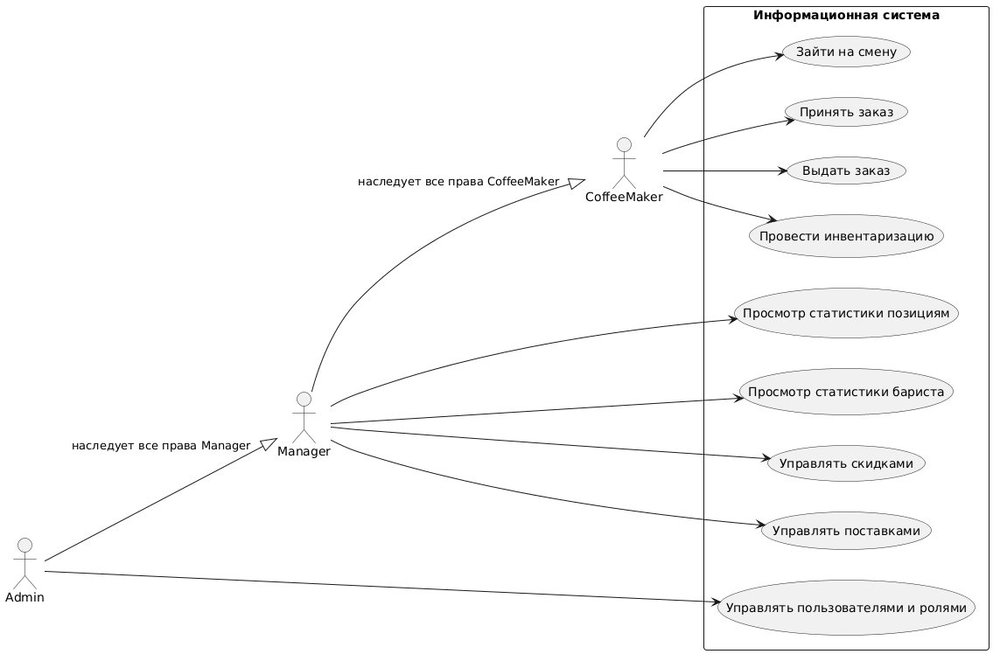

Сеть кофейнь. ИС предназначена только для сотрудников. Кофейня продаёт кофе, десерты и сендвичи. Каждый тип кофе характеризуется ценой и затраичваемыми ингредиентами(молоко, зерна кофе и сиропы). За каждым продуктом заведён счетчик в бд, который увеличивается с каждой продажей. Ингредиенты, десерты и сендвичи заказываются у поставщика раз в несколько дней. Каждую неделю в каждой кофейне производится инвентаризация. В зависимости от итогов инвентаризации частота поставок в отдельные кофейни может меняться. Есть баристы. Бариста с помощью компьютера заходит на смену (через ввод логина и пароля). На одном компьютере может быть залогинено одновременно несколько человек. Каждый бариста берёт и выдаёт заказы в своей вкладке. В бд за каждым бариста сохраняется количество принятых и выполненных заказов. Есть менеджеры. Менеджеры видят количество продаж каждой позиции и могут запускать скидки на отдельные позиции и/или категории. Менеджеры видят количество принятых и выполненных заказов каждого бариста.
